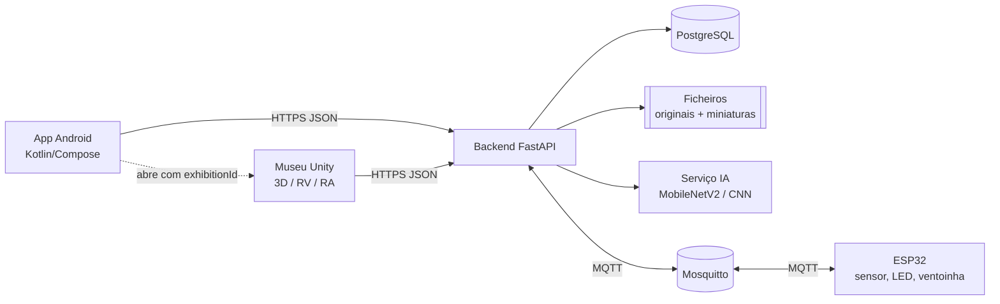

# Contratos v1 — Museu Virtual Pessoal

Fonte de verdade partilhada por Android (Kotlin), Unity (C#), backend (FastAPI) e módulo IoT (ESP32/simulador).
Qualquer alteração incompatível cria `v2`; não se mudam campos de `v1` em silêncio.

## 1. Arquitetura mínima



Regras:
- Android e Unity **nunca** falam MQTT diretamente; comandos passam sempre pela API (`POST /devices/{id}/commands`).
- O Unity recebe só IDs (`exhibitionId`, sessão) da app e resolve o resto pela API.

## 2. Convenções

| Item | Regra |
|------|-------|
| IDs | UUID v4 em texto (`"3f0c…"`) para fotografia, exposição, quadro, moldura física, dispositivo e comando |
| Datas | ISO 8601 em UTC com `Z`: `2026-11-22T14:05:00Z` |
| JSON | `camelCase` nos campos |
| Versão da ficha | `version` inteiro, incrementa a cada alteração da fotografia |
| Erros HTTP | `{"detail": "<mensagem>"}` com 400/401/403/404/409/413/415/422 |
| Base URL | `/api/v1` (desenvolvimento: `http://<pc>:8000/api/v1`) |

## 3. Recursos HTTP

### Fotografia (`PhotoOut`)
```json
{
  "id": "6b1d2c9e-0c1a-4a57-9a8e-0c3f8f1d2a10",
  "title": "Praia da Nazaré",
  "description": "Fim de tarde",
  "memory": "Primeiro dia de férias com a família",
  "takenAt": "2026-08-14T18:30:00Z",
  "location": "Nazaré",
  "width": 4032, "height": 3024,
  "mimeType": "image/jpeg",
  "fileUrl": "/api/v1/photos/6b1d…/file",
  "thumbnailUrl": "/api/v1/photos/6b1d…/thumbnail",
  "labels": [
    {"name": "praia", "score": 0.91, "source": "ai", "modelVersion": "mobilenetv2-0.1", "confirmed": false},
    {"name": "familia", "score": null, "source": "human", "modelVersion": null, "confirmed": true}
  ],
  "exhibitionIds": ["a2c4…"],
  "version": 3,
  "createdAt": "2026-11-22T14:05:00Z",
  "updatedAt": "2026-11-22T14:10:00Z"
}
```
- `source: "ai"` = sugestão (candidata); só `confirmed: true` conta como categoria da ficha.
- `score` nunca é mostrado como certeza.

| Método | Caminho | Notas |
|--------|---------|-------|
| GET | `/health` | `{"status":"ok"}` |
| POST | `/photos` | `multipart/form-data`, campo `file`; JPEG/PNG/WEBP, máx. 10 MB → 201 `PhotoOut` |
| GET | `/photos` | lista `PhotoOut` (filtros `?exhibitionId=`, `?label=`) |
| GET | `/photos/{id}` | `PhotoOut` |
| PATCH | `/photos/{id}` | `PhotoUpdate` (campos opcionais: `title`, `description`, `memory`, `takenAt`, `location`, `labels`); `labels` substitui a lista |
| DELETE | `/photos/{id}` | 204; apaga original, miniatura e associações |
| GET | `/photos/{id}/file`, `/photos/{id}/thumbnail` | bytes da imagem (miniatura JPEG ≤ 400 px) |

### Exposição (`ExhibitionOut`)
```json
{
  "id": "a2c4…",
  "name": "Verão 2026",
  "description": null,
  "photos": [{"photoId": "6b1d…", "position": 0}],
  "createdAt": "2026-11-22T14:00:00Z",
  "updatedAt": "2026-11-22T14:00:00Z"
}
```

| Método | Caminho | Notas |
|--------|---------|-------|
| GET / POST | `/exhibitions` | POST `{"name": "...", "description": null}` → 201 |
| GET / PATCH / DELETE | `/exhibitions/{id}` | DELETE não apaga fotografias |
| PUT | `/exhibitions/{id}/photos/{photoId}` | body `{"position": 0}`; associa ou move |
| DELETE | `/exhibitions/{id}/photos/{photoId}` | desassocia |

`position` define o slot da moldura no Unity: a mesma lista gera sempre a mesma disposição.

### Análise IA (S3)
`POST /photos/{id}/analyze` → `{"taskId": "...", "status": "pending"}`;
`GET /analysis/{taskId}` → `status ∈ pending|running|done|failed` + `labels` quando `done`.

### Dispositivos e comandos
```json
{
  "id": "d1…", "kind": "light", "name": "Luz da exposição",
  "online": true, "lastSeen": "2026-11-22T14:05:00Z",
  "observedState": {"on": true}
}
```
`kind ∈ sensor|light|fan`.

| Método | Caminho | Notas |
|--------|---------|-------|
| GET | `/devices` | lista dispositivos com último estado observado |
| GET | `/devices/{id}/readings/latest` | última leitura `{"value": 21.4, "unit": "C", "measuredAt": "..."}` |
| POST | `/devices/{id}/commands` | `{"desiredState": {"on": true}, "commandId": "<uuid opcional>"}` → 202 `CommandOut` |
| GET | `/commands/{id}` | `CommandOut` |

`CommandOut`:
```json
{
  "id": "c9…", "deviceId": "d1…",
  "desiredState": {"on": true},
  "status": "requested",
  "createdAt": "...", "updatedAt": "...", "expiresAt": "..."
}
```
Estados: `requested → sent → confirmed | failed | timeout`.
`requested` = guardado mas o broker não aceitou a publicação; `sent` = publicado no MQTT (confirmação de transporte); `timeout` = sem `ack` até `expiresAt` ou `ack` com `expired`.
`confirmed` só depois do `ack` do dispositivo com o estado **observado**. Sem toggle: envia-se sempre o estado pretendido.
Repetir `POST` com o mesmo `commandId` devolve o mesmo comando (idempotente).

## 4. MQTT

Prefixo `museu/v1`. QoS 1. JSON UTF-8.

| Tópico | Sentido | Retido | Payload |
|--------|---------|--------|---------|
| `museu/v1/readings/{deviceId}` | IoT → servidor | não | `{"value": 21.4, "unit": "C", "measuredAt": "...Z"}` |
| `museu/v1/status/{deviceId}` | IoT → servidor | sim (LWT `{"online": false}`) | `{"online": true, "observedState": {"on": false}, "ts": "...Z"}` |
| `museu/v1/commands/{deviceId}` | servidor → IoT | não | `{"commandId": "<uuid>", "desiredState": {"on": true}, "expiresAt": "...Z"}` |
| `museu/v1/ack/{deviceId}` | IoT → servidor | não | `{"commandId": "<uuid>", "result": "applied"\|"rejected"\|"expired", "observedState": {"on": true}, "ts": "...Z"}` |

Regras do dispositivo:
- Ignora comandos com `expiresAt` no passado (`ack` com `result: "expired"`).
- Guarda os últimos `commandId` aplicados; um repetido recebe o mesmo `ack` sem voltar a atuar.
- Depois de atuar publica `ack` **e** `status` com o estado lido.

## 5. Ligação Android → Unity

Intent/extra (ou mensagem UnityPlayer) com:
```json
{"exhibitionId": "a2c4…", "apiBaseUrl": "http://…/api/v1", "sessionToken": "<token>"}
```
O token nunca é escrito em logs.
